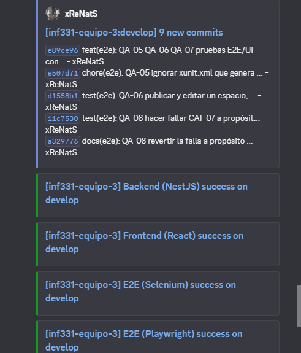
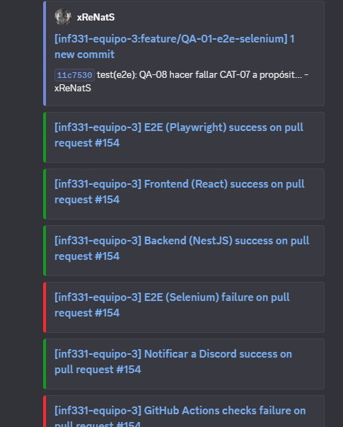

# Entrega 3: pruebas de interfaz con Selenium

Documento de la Entrega 3 del ramo INF331 (equipo 3). Sigue el orden del Anexo B de la pauta. La misma información se publica en la página «Entrega 3» de la Wiki.

## Objetivo de la Entrega 3

Sumar pruebas de interfaz (E2E/UI) a RentSmart, que corran solas dentro del pipeline de la Entrega 2 y dejen evidencia clara de cada ejecución. Queda así:

- 25 pruebas E2E/UI con **Selenium WebDriver**, sobre el stack real (base de datos, API y front), en Chrome headless.
- Un job nuevo, «E2E (Selenium)», en el workflow de GitHub Actions que levanta ese stack, corre las pruebas y falla el pipeline si una prueba falla.
- Reportes, logs y screenshots de las fallas como artefactos descargables, y un resumen en cada ejecución.
- Un job de empaquetado que genera los paquetes del back y del front cuando todo pasa.
- Aviso del resultado al canal de Discord del equipo.

## Qué corregimos desde las entregas 1 y 2

Esta tabla resume cada observación de las rúbricas anteriores, qué hicimos en esta entrega y dónde se puede comprobar. Lo que sigue pendiente queda dicho en la misma fila.

| Observación (entrega) | Qué hicimos | Dónde verlo |
|---|---|---|
| El enlace al video quedó como `PENDIENTE` en el tag y en la Wiki (E1) | Enlaces a los videos de las entregas 1 y 2 en el README y la Wiki. El de esta entrega se agrega antes de publicar el release, no después | README («Enlaces»), Wiki (Inicio y Entrega 1) |
| Agregar pruebas E2E (E1) | Smoke con Playwright desde la Entrega 2 y 25 pruebas E2E/UI con Selenium contra el stack real en esta | [Set de pruebas](#set-de-pruebas) |
| Subir la cobertura del back, 45,6 % (E1) | 57 % en la Entrega 2 y 62,1 % de líneas en esta | README («Pruebas») y resumen de cada ejecución del CI |
| GitFlow aplicado tarde: casi todo entró directo a `main` (E1) | Cada historia en una rama `feature/<ID>` con PR a `develop`; la entrega pasa a `main` por `release/v3.0-entrega3` con su tag | PRs #149, #154 a #160 |
| Commits concentrados en una persona (E1) y sin aportes de Renato en la Entrega 2 (E2) | Trabajo repartido por dominio: A, IA y panel del arrendatario; B, calendario y suite Selenium; C, webhook de Stripe, confirmación automática y revisión del CI | [Metodología de trabajo](#metodología-de-trabajo) |
| Sin JIRA (E1) | Seguimos con los issues y milestones de GitHub como tablero Kanban, cada tarea con criterios, responsable y estimación en horas | [Milestone «Entrega 3»](https://github.com/AlejandroMG/inf331-equipo-3/milestone/8) |
| Foco CI/CD con poco aporte y sin una justificación sólida frente a Jenkins (E2) | Comparación criterio por criterio, y tres etapas nuevas: «E2E (Selenium)», «Empaquetar» y el reporte de pruebas como check | [Por qué GitHub Actions y no Jenkins](#por-qué-github-actions-y-no-jenkins), [El pipeline](#el-pipeline) |
| Para la Entrega 3: empaquetado o deploy en el pipeline (E2) | Job «Empaquetar»: si todas las pruebas pasan, genera los paquetes del back y del front con un manifiesto. Además, el despliegue en una VM de Azure con Docker Compose y un workflow de CD que despliega en cada merge a `main` (QA-03, P-17); probado en local, en Azure falta crear la VM | Artefacto `rentsmart-paquetes` de cada ejecución, [Despliegue continuo](#despliegue-continuo) |
| Para la Entrega 3: reportes de pruebas publicados (E2) | Resumen en cada ejecución, check «Reporte E2E (Selenium)» con el resultado de cada prueba, y artefactos con el reporte HTML, el JUnit y los screenshots | [Evidencias](#evidencias) |
| Notificación a Discord sin paso en el workflow ni capturas (E2) | Documentamos la integración de GitHub con Discord, que avisa el resultado de cada job, con capturas de una ejecución en verde y una en rojo. Además, un job `notify` opcional con el resultado global | [Notificaciones a Discord](#notificaciones-a-discord) |
| Trazabilidad: badge, historial y capturas (E2) | Badges del CI de `develop` y `main` en el README, enlaces a ejecuciones verde y roja, y capturas en esta página | README, [Evidencias](#evidencias) |
| El README no se actualizó: seguía «Estado de la Entrega 1», sin video E2 ni badge (E2) | README con el estado de la Entrega 3, videos, releases, badges y la evolución de pruebas y cobertura | README |
| Las notas del release v2 decían que los reembolsos quedaban para después, y el CHANGELOG no se actualizó (E2) | CHANGELOG con las entradas v2 (con la corrección) y v3; las notas del release v3 repiten la corrección | `CHANGELOG.md`, release `v3.0-entrega3` |
| El PR #144 se mergeó sin revisión y con el CI corriendo; `develop` sin proteger (E2) | Desde el 19 de noviembre, el ruleset «Protect main and Develop» exige en `develop` un PR con una aprobación y los checks Backend y Frontend en verde. Antes de crearlo, esta semana todavía se mergearon PRs sin revisión (#148 y #155 a #158). Después se sumaron como obligatorios los checks «E2E (Playwright)» y «E2E (Selenium)» | Settings → Rules del repositorio, [Metodología de trabajo](#metodología-de-trabajo) |
| Explicar en la documentación «cómo lo arreglamos» (E2) | Once problemas, cada uno con qué pasó, cómo lo detectamos y cómo lo arreglamos | [Problemas encontrados y soluciones](#problemas-encontrados-y-soluciones) |

## Herramienta E2E elegida

**Selenium WebDriver** con JavaScript y **Mocha** como ejecutor.

- **Por qué Selenium:** es la herramienta por defecto de la pauta. Playwright, la otra que conocíamos, ya se usó en la Entrega 2 (smoke test), y la pauta solo permite una alternativa si no se usó antes.
- **Por qué JavaScript y Mocha:** todo el repo es Node, así que el equipo no suma otro lenguaje ni otro entorno al CI. Mocha da un ejecutor sencillo con reportes JUnit y HTML.
- **Qué pasa con Playwright:** se mantiene como smoke test rápido contra la API simulada (job «E2E (Playwright)»). Los dos jobs se complementan: el smoke avisa en segundos si la app no arranca y Selenium recorre los flujos completos.

El proyecto está en [`e2e-selenium/`](../e2e-selenium/README.md) y tiene su propio `package.json`.

## Set de pruebas

Hay 25 pruebas en 5 archivos. Cada una es un flujo de usuario, no una prueba unitaria.

| ID | Qué valida |
|---|---|
| **CAT-01** | La página de inicio muestra el catálogo con los espacios del seed |
| **CAT-02** | Buscar por texto deja solo los espacios que coinciden |
| **CAT-03** | Una búsqueda sin coincidencias avisa que no hay resultados |
| **CAT-04** | Filtrar por tipo de espacio reduce el listado y queda en la URL |
| **CAT-05** | Ordenar por precio de menor a mayor deja los precios por hora en orden creciente |
| **CAT-06** | Desde el catálogo se abre el detalle de un espacio, con su panel de reserva |
| **CAT-07** | Una ruta que no existe muestra la página de error 404 |
| **AUT-01** | Registrarse con campos vacíos muestra los errores y no envía nada |
| **AUT-02** | Registrarse con datos válidos crea la cuenta y lleva al login con el email cargado |
| **AUT-03** | Registrarse con un email ya usado muestra el error |
| **AUT-04** | Iniciar sesión con contraseña incorrecta muestra el error y no entra |
| **AUT-05** | Iniciar sesión con el usuario del seed entra, y «Salir» vuelve a la vista pública |
| **AUT-06** | Una ruta protegida sin sesión redirige al login y, al entrar, vuelve a esa ruta |
| **AUT-07** | Una cuenta sin rol de administrador recibe el 403 en el panel de administración |
| **AUT-08** | La cuenta administradora sí accede a la moderación de espacios |
| **OWN-01** | «Mis espacios» lista los espacios del propietario y su resumen |
| **OWN-02** | Publicar desde el formulario: se completa un borrador subiendo la foto, se publica y aparece en el catálogo |
| **OWN-03** | Editar un espacio publicado cambia su nombre en el detalle público |
| **OWN-04** | Desactivar un espacio lo saca del catálogo público; activarlo lo devuelve |
| **OWN-05** | Un borrador aparece en «Mis espacios» y se elimina con confirmación |
| **BOK-01** | Sin sesión, elegir horas y reservar lleva al login |
| **BOK-02** | El arrendatario reserva un bloque y ve su reserva pendiente de pago con el desglose |
| **BOK-03** | Una reserva no se puede ver sin sesión |
| **FAV-01** | Guardar un espacio en favoritos lo muestra en «Mis favoritos» y se puede quitar |
| **PRF-01** | Editar el nombre en «Mi perfil» queda guardado tras recargar |

**Escenarios críticos cubiertos** (los de la pauta):

| Escenario de la pauta | Pruebas |
|---|---|
| CRUD happy path | Espacio: OWN-02 (crear y publicar), OWN-01 (listar), CAT-06 (ver detalle), OWN-03 y OWN-04 (editar), OWN-05 (eliminar). Además BOK-02 (crear una reserva), PRF-01 (editar el perfil) y FAV-01 (crear y quitar un favorito) |
| Validaciones y errores | AUT-01, AUT-03, AUT-04, CAT-03, CAT-07 |
| Búsqueda y filtro | CAT-02, CAT-03, CAT-04, CAT-05 |
| Login y permisos | AUT-04 a AUT-08, BOK-01, BOK-03 |
| Navegación clave | CAT-01, CAT-06, OWN-01 |

**Cómo se arma el CRUD.** La entidad central es el espacio. Publicar es un formulario de cinco pasos; la prueba OWN-02 parte de un borrador con los datos y el horario ya cargados por API y recorre en la interfaz la parte que la persona completa: sube la foto, revisa y publica, y abre el espacio en el catálogo. OWN-03 lo edita desde «Mis espacios», OWN-04 lo desactiva y lo reactiva, y OWN-05 elimina un borrador. Cada prueba crea su propio espacio, así que no se toca ninguno del seed.

**Qué no cubre.** El pago con Stripe Checkout y la confirmación automática de la reserva (el back del E2E corre sin `STRIPE_SECRET_KEY`, así que la reserva queda pendiente de pago). Sigue pendiente en [QA-01](https://github.com/AlejandroMG/inf331-equipo-3/issues/64).

## Cómo ejecutar en local

**Requisitos:** Node.js 24.9 o superior, Google Chrome y Docker (o una PostgreSQL 17). Selenium Manager descarga el `chromedriver`.

Los pasos completos (base de datos, back, front y pruebas) están en [`e2e-selenium/README.md`](../e2e-selenium/README.md#cómo-correrlas-en-local). En resumen:

```bash
# base de datos, migraciones y seed; luego el back (3000) y el front compilado (4173)
cd e2e-selenium
npm install
npm test                 # headless
HEADLESS=false npm test  # con el navegador visible
```

| Variable | Por defecto | Para qué |
|---|---|---|
| `BASE_URL` | `http://localhost:4173` | Dónde corre el front |
| `API_URL` | igual a `BASE_URL` | Base de la API para preparar datos |
| `HEADLESS` | `true` | `false` abre el navegador |
| `WAIT_MS` | `10000` | Espera máxima de un elemento |

**Datos de prueba.** El seed del back deja tres usuarios (`admin@`, `propietario@` y `arrendatario@rentsmart.test`, contraseña `Password123`) y 10 espacios activos. Las pruebas crean por API sus propias cuentas (con emails únicos) y sus espacios (con la foto de `e2e-selenium/fixtures/espacio.png`), y las reservas eligen horarios al azar, así que no dependen del orden ni de corridas anteriores. Los datos del seed solo se leen; la excepción es BOK-02, que crea una reserva del arrendatario del seed.

## Integración con CI/CD

### Por qué GitHub Actions y no Jenkins

La pauta propone Jenkins y acepta GitHub Actions bien justificado. Lo evaluamos en la Entrega 2 y lo mantenemos por estas razones:

| Criterio | Jenkins | GitHub Actions (lo que usamos) |
|---|---|---|
| Infraestructura | Un servidor propio, encendido y accesible desde GitHub. En local exige Ngrok y la URL cambia en cada sesión | Runners de GitHub, sin servidor que mantener ni túnel que exponer |
| Gatillo desde GitHub | Webhook del repo hacia Jenkins, más el plugin de GitHub para devolver el estado | Nativo: cada push y PR dispara el workflow y el resultado queda como check del commit |
| Bloquear el merge si falla | Requiere publicar el estado de vuelta en GitHub | El ruleset de `main` y `develop` exige los checks antes de mergear |
| Secretos | Credenciales en el servidor de Jenkins | Secretos cifrados del repositorio; nunca aparecen en los logs |
| Servicios para las pruebas | Docker instalado en el agente | `services:` levanta PostgreSQL 17 por job |
| Artefactos y reportes | Plugins (JUnit, HTML Publisher) | `upload-artifact`, el resumen de la ejecución y los checks |
| Costo para el equipo | Horas de instalación, actualizaciones de plugins y un servidor | Gratis en un repositorio público |
| Dónde se ve el pipeline | Otra herramienta, con su propio acceso | En el mismo repositorio que revisa el profesor |

Lo que pide la pauta de Jenkins se cumple igual: el pipeline se gatilla solo, tiene etapas explícitas (lint, pruebas, build, E2E, empaquetado y despliegue), falla ante cualquier error, deja historial y logs, y avisa el resultado al canal del equipo.

### El pipeline

Está en [`.github/workflows/ci.yml`](../.github/workflows/ci.yml). Se gatilla con cada push a `main` y `develop` y con cada pull request hacia `main`, `develop` o `release/**`.

| Etapa (job) | Qué hace | Si falla |
|---|---|---|
| **Backend (NestJS)** | Lint, pruebas unitarias con cobertura, pruebas de integración de la API contra PostgreSQL y build | El pipeline queda en rojo |
| **Frontend (React)** | Lint, pruebas de componentes y build | El pipeline queda en rojo |
| **E2E (Playwright)** | Smoke test con la API simulada | El pipeline queda en rojo |
| **E2E (Selenium)** | Levanta el stack real y corre las 25 pruebas E2E/UI (detalle abajo) | El pipeline queda en rojo y se suben los screenshots |
| **Empaquetar** | Solo si todo lo anterior pasó: build del back y del front, paquetes `.tar.gz` y un manifiesto con la versión | No se generan paquetes |
| **Notificar a Discord** | Mensaje único con el resultado global (opcional, ver abajo) | No afecta el resultado |

**El job «E2E (Selenium)»**, en orden:
1. Levanta PostgreSQL 17 como servicio del job.
2. Instala el back, genera el cliente de Prisma, migra, siembra y compila.
3. Compila el front con `VITE_API_URL` apuntando a su propio origen.
4. Arranca la API (3000) y el front con `vite preview` (4173), que reenvía `/api` a la API, y espera a que respondan.
5. Instala `e2e-selenium` y corre `npm test` en Chrome headless.
6. Escribe el resumen en la ejecución, sube los artefactos y publica el reporte como el check «Reporte E2E (Selenium)», con el resultado de cada prueba.

**OK o FAIL:** `npm test` termina con código distinto de cero si falla una prueba, el job queda en rojo y el check del PR también. El ruleset de `main` y `develop` no deja mergear si «Backend (NestJS)», «Frontend (React)», «E2E (Playwright)» o «E2E (Selenium)» están en rojo.

**Empaquetado.** El job «Empaquetar» deja el artefacto `rentsmart-paquetes`, que dura 30 días:
- `rentsmart-back-<versión>.tar.gz`: código compilado, `package.json`, `package-lock.json` y migraciones. En un servidor se instala con `npm ci --omit=dev && npx prisma migrate deploy && node dist/main.js`.
- `rentsmart-front-<versión>.tar.gz`: archivos estáticos para cualquier servidor web.
- `manifiesto.txt`: versión, commit, rama, fecha y la URL de la API con que se compiló el front. La variable de repositorio `PACKAGE_API_URL` fija esa URL para un ambiente real.

### Despliegue continuo

El despliegue es de QA-03 (C, PR #161) y está decidido en P-17: la aplicación completa corre en una sola VM Linux de Azure con Docker Compose.

- **`docker-compose.prod.yml`** levanta tres contenedores: PostgreSQL 17, la API (aplica las migraciones pendientes al arrancar) y Caddy, que sirve el front, reenvía `/api` y `/docs` a la API y saca solo el certificado HTTPS. Front y API quedan en el mismo origen, sin CORS.
- **`.github/workflows/deploy.yml`** despliega en cada push a `main`, o a mano con *Run workflow*: entra por SSH a la VM, cambia el código a esa rama, reconstruye con `up -d --build --wait` y comprueba que `https://<dominio>/api/catalog` responda. Si la comprobación falla, el workflow queda en rojo.
- **Secretos:** `DEPLOY_HOST`, `DEPLOY_USER` y `DEPLOY_SSH_KEY` en GitHub; las variables de la aplicación viven solo en `.env.prod` dentro de la VM (plantilla en `.env.prod.example`). Sin los secretos, el workflow termina sin hacer nada.
- **Estado:** el stack de producción se probó en local (los tres contenedores sanos, migraciones, seed, front, API, Swagger y login a través de Caddy). Falta crear la VM en Azure y probar el workflow con HTTPS real. El paso a paso está en el README, sección «Desplegar en Azure».

Así el pipeline completo queda en dos workflows: `ci.yml` prueba y empaqueta cada cambio, y `deploy.yml` publica lo que llega a `main`.

**Variables:** `BASE_URL` (se fija en el workflow), `DATABASE_URL` y `JWT_SECRET` (solo para el CI; no son secretos reales), `PACKAGE_API_URL` (variable de repositorio, opcional) y `DISCORD_WEBHOOK_URL` (secreto, opcional).

### Notificaciones a Discord

El equipo usa Discord en vez de Slack, como declaramos desde la Entrega 1. El canal del equipo recibe dos tipos de aviso de la integración de GitHub con Discord:
- los commits que llegan a cada rama, con su autor y el enlace;
- el resultado de cada job del pipeline, en verde si pasó y en rojo si falló, por ejemplo «E2E (Selenium) success on develop».

Esa integración no necesita un paso en el workflow: GitHub envía los eventos al webhook del canal. Además, el job `notify` puede enviar un mensaje único con el resultado del pipeline completo, el autor y el enlace a la ejecución, si se configura el secreto `DISCORD_WEBHOOK_URL`. Sin el secreto, el envío se omite.

## Evidencias

| Evidencia | Dónde |
|---|---|
| Historial y logs | [Pestaña Actions](https://github.com/AlejandroMG/inf331-equipo-3/actions/workflows/ci.yml) y badge del CI en el README |
| Resumen de resultados | Resumen de cada ejecución: tabla de Selenium (pruebas, pasaron, fallaron, duración), cobertura del back y paquetes generados |
| Resultado de cada prueba E2E | Check «Reporte E2E (Selenium)» en el commit o el PR |
| Reporte HTML y JUnit | Artefacto `selenium-report` (`index.html`, `index.json`, `junit.xml`, `api.log`, `front.log`) |
| Screenshots de fallas | Artefacto `selenium-screenshots`: por cada prueba que falla, un `.png`, el `.html` de la página y el `.log` de la consola |
| Paquetes | Artefacto `rentsmart-paquetes` |
| Avisos en Discord | Canal del equipo (capturas de una ejecución en verde y una en rojo, abajo) |

**Ejecuciones de ejemplo:**

| Ejecución | Resultado | Qué muestra |
|---|---|---|
| [En verde](https://github.com/AlejandroMG/inf331-equipo-3/actions/runs/44400210124) (PR #154, commit `d1558b1`) | ✅ 25 de 25 | El pipeline completo en verde, con el resumen de Selenium y el artefacto `selenium-report` |
| [En rojo, a propósito](https://github.com/AlejandroMG/inf331-equipo-3/actions/runs/44400582392) (PR #154, commit `11c7530`) | ❌ 24 de 25 | CAT-07 espera un título que no existe. El job «E2E (Selenium)» falla y marca el pipeline en rojo. El log dice qué prueba falló y dónde quedó su evidencia, y el artefacto `selenium-screenshots` trae el `.png`, el `.html` y el `.log` de la consola |
| [`develop` con todo integrado](https://github.com/AlejandroMG/inf331-equipo-3/actions/runs/44534150769) (commit `13a5ca7`) | ✅ | Las 25 pruebas sobre `develop` con pagos, IA y paneles ya mergeados |

El commit que hace fallar CAT-07 se revirtió en el siguiente, que vuelve a dejar el pipeline en verde.

**Aviso en Discord de una ejecución en verde** (`develop`, después de mergear la Entrega 3): llegan los commits nuevos y el resultado de cada job, entre ellos «E2E (Selenium) success on develop».



**Aviso en Discord de una ejecución en rojo** (la falla a propósito del PR #154, commit `11c7530`): «E2E (Selenium) failure on pull request #154» y «GitHub Actions checks failure», junto a los jobs que sí pasaron.



## Problemas encontrados y soluciones

Para cada problema: qué pasó, cómo lo detectamos y cómo lo arreglamos.

| # | Problema | Cómo lo detectamos | Cómo lo arreglamos |
|---|---|---|---|
| 1 | La API limita el login a 10 intentos por IP cada 15 minutos (CU-05) y las corridas terminaban en `429 Too Many Requests` | La segunda corrida seguida de la suite fallaba en pruebas que en la primera pasaban; el error de la API lo decía | Cada usuario inicia sesión por API una sola vez por ejecución y se reutiliza su token; solo las pruebas del formulario de login pasan por la interfaz. Una corrida usa 7 de los 10 intentos. En el CI no pasa porque cada ejecución arranca una API nueva |
| 2 | La pauta pide Selenium y Playwright ya se había usado en la Entrega 2 | Al leer la pauta: solo se puede usar otra herramienta si no se usó antes | Selenium para la suite de la entrega y Playwright como smoke test rápido |
| 3 | Mocha no generaba los reportes JUnit y HTML | La carpeta `reports/` no existía después de una corrida en verde | Las opciones del multi-reporter iban dentro de `.mocharc.cjs` y no se aplicaban; se pasaron a un archivo aparte, `reporter-config.json` |
| 4 | El catálogo vacío y las tarjetas comparten la etiqueta `h3`, y la prueba contaba el aviso como si fuera un espacio | CAT-03 fallaba con «1 !== 0» y el screenshot mostraba el aviso «No encontramos espacios» | Las tarjetas se identifican por su enlace: `a[href^="/spaces/"] h3` |
| 5 | OWN-02 desactivaba un espacio del seed y FAV-01 cambiaba los favoritos del arrendatario del seed | Lo observó C en la revisión del PR #154: si fallaba el paso que restauraba los datos, otras pruebas dependían del resultado | Cada prueba crea sus datos por API: espacios publicados propios (con la foto de `fixtures/espacio.png`) y una cuenta propia |
| 6 | CAT-05 dependía de cómo el seed calcula los precios | Revisión de C en el PR #154 | La prueba lee el precio por hora de cada tarjeta y comprueba que vayan en orden creciente |
| 7 | Los campos del formulario de publicar no tienen atributo `name`, y Selenium no tiene `getByRole` como Playwright | Las pruebas no encontraban el campo «Nombre del espacio» | Se localiza por la etiqueta visible (el `id` del campo es el `for` del `<label>`), el texto de los botones y los `aria-label`, que la interfaz ya trae por accesibilidad |
| 8 | Después de integrar `develop`, el back no compilaba en local | El build fallaba al importar `stripe` | Faltaba instalar dependencias nuevas y regenerar el cliente de Prisma: `npm ci` y `npx prisma generate` antes de compilar, el mismo orden que ya usa el CI |
| 9 | La confirmación automática de reservas (RE-04) no llegó a `develop` | Al revisar los PRs: #157 apuntaba a la rama de PA-02 y se mergeó ahí un minuto después de que esa rama entrara a `develop` | PR #158 con `develop` más la rama de PA-02, sin cambiar código. Aprendizaje: con PRs apilados, cambiar la base del de arriba a `develop` antes de mergearlo |
| 10 | Los issues no se cerraban al mergear | Seguían abiertos después del merge | GitHub solo cierra issues con «Closes #N» cuando el PR va a la rama por defecto (`main`); como los PRs van a `develop`, se cierran a mano al mergear |
| 11 | Ya había bases de datos de otros proyectos en los puertos 5432 y 5433 de una máquina del equipo | Docker fallaba con «port is already allocated» | La base de las pruebas E2E usa el puerto 5434, en local y en el CI |

## Metodología de trabajo

- **Tablero Kanban y estimaciones:** usamos los issues y milestones de GitHub en vez de JIRA, como declaramos desde la Entrega 1. Las tareas de esta entrega están en el [milestone «Entrega 3»](https://github.com/AlejandroMG/inf331-equipo-3/milestone/8) (QA-05 a QA-08), cada una con criterios de aceptación, responsable y estimación en horas; las historias anteriores tienen estimación en puntos. El estado de cada tarea (abierta, con PR, cerrada) y sus criterios marcados muestran el avance.
- **GitFlow:** cada historia en una rama `feature/<ID>-…` desde `develop`, con PR hacia `develop`; la entrega pasa a `main` por `release/v3.0-entrega3` con su tag.
- **Revisión:** el PR #154 (Selenium) tuvo revisión de C con cambios pedidos, que se resolvieron antes de mergear. Reconocemos que esta semana se mergearon PRs sin revisión (#148 y #155 a #158) por el apuro de la entrega; para corregirlo, desde el 19 de noviembre el ruleset «Protect main and Develop» exige en `develop`, igual que en `main`, un PR con una aprobación y los checks de Backend y Frontend en verde.
- **Reparto:** A hizo IA-01, IA-02 y el panel del arrendatario (PN-03); B, el calendario de disponibilidad (BU-06), la suite de Selenium y su integración al pipeline; C, la confirmación del pago por webhook (PA-02), la confirmación automática de reservas (RE-04), la revisión del CI y el despliegue en Azure (QA-03).

## Pendientes y mejoras futuras

- Pago con Stripe Checkout y confirmación automática de la reserva dentro del E2E (QA-01).
- Cancelar una reserva desde la interfaz y su prueba BOK-04 (C).
- Crear la VM de Azure, cargar los secretos `DEPLOY_*` y probar el despliegue real con HTTPS y el webhook de Stripe apuntando a ella (QA-03).
- Una variable de entorno para subir el límite de login en el entorno de pruebas, para repetir la suite sin reiniciar la API (módulo `auth`, de A).
- Recorrer en la interfaz los pasos 1 a 3 del formulario de publicar (datos, ubicación con el mapa y horario semanal); hoy se cargan por API y la prueba completa la foto y la publicación.
- Ejecutar las pruebas a 375 px y en otros navegadores.
